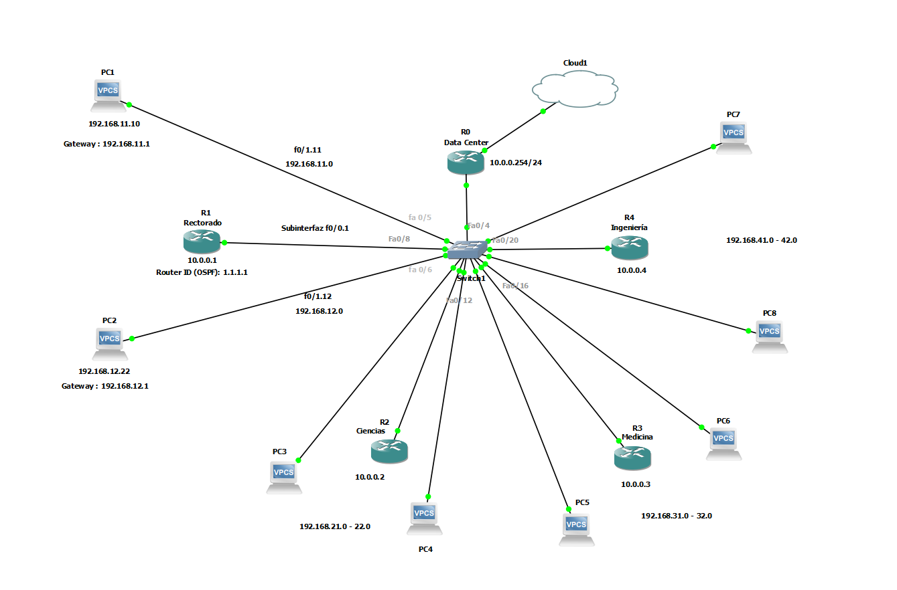
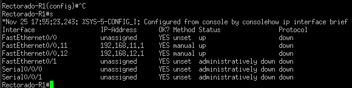
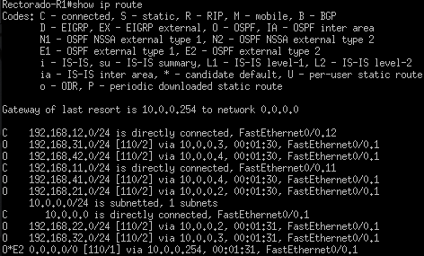
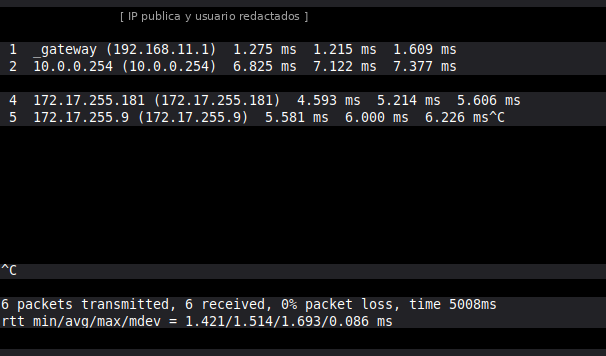

# Campus Network Integration: VLANs, DHCP, OSPF and NAT

**English** | [Español](#integración-de-red-universitaria-vlans-dhcp-ospf-y-nat)

Lab project for the Computer Networks course (Facultad de Ciencias, UCV, semester II-2025). Four university faculties are connected through a central Data Center router, with automatic addressing, dynamic routing and Internet access.

I took part in the configuration of all four routers (R1 to R4), in a team of four people. This repository documents that work.

## Goals
- Separate each faculty into two VLANs with 802.1Q encapsulation on a router-on-a-stick.
- Provide automatic addressing with DHCP per VLAN, reserving addresses for static hosts.
- Exchange routes between faculties with OSPF (area 0).
- Give Internet access from the Data Center through NAT (PAT) with a default route.

## Architecture
- **R0 (Data Center):** core router, IP 10.0.0.254 on the transit network, runs OSPF, default route to the ISP and PAT.
- **R1 to R4 (faculties):** one physical link to the core. Each has two VLANs (subinterfaces `f0/0.x1` and `f0/0.x2`), DHCP for its hosts and OSPF.
- **Transit network:** 10.0.0.0/24, where each faculty router has an address from .1 to .4.

## Address plan
The table was generated with `plan_direccionamiento.py`.

| Faculty | VLAN | Network | Gateway | Static (.10) | DHCP pool |
|---|---|---|---|---|---|
| R1 Rectorado | 11 | 192.168.11.0/24 | .1 | .10 | .21 – .254 |
| R1 Rectorado | 12 | 192.168.12.0/24 | .1 | .10 | .21 – .254 |
| R2 Ciencias | 21 | 192.168.21.0/24 | .1 | .10 | .21 – .254 |
| R2 Ciencias | 22 | 192.168.22.0/24 | .1 | .10 | .21 – .254 |
| R3 Medicina | 31 | 192.168.31.0/24 | .1 | .10 | .21 – .254 |
| R3 Medicina | 32 | 192.168.32.0/24 | .1 | .10 | .21 – .254 |
| R4 Ingeniería | 41 | 192.168.41.0/24 | .1 | .10 | .21 – .254 |
| R4 Ingeniería | 42 | 192.168.42.0/24 | .1 | .10 | .21 – .254 |

The first 20 addresses of each network are excluded from DHCP. DNS for all pools is 8.8.8.8.

## Verification
- `show ip interface brief`: subinterfaces up with their gateway.
- `show vlan brief` and `show interfaces trunk`: VLANs created and trunk to the routers.
- `show ip dhcp binding`: hosts that received an address dynamically.
- `show ip route`: routes learned from OSPF (marked with O).
- `ping 8.8.8.8` from a faculty host, and `show ip nat translations` on R0.

## Requirements and evidence
| Requirement | Evidence |
|---|---|
| Two VLAN subinterfaces per faculty, with gateway | `subinterfaces_vlans_R1.png`, `show_ip_interface_brief.png` |
| 802.1Q encapsulation on the router-on-a-stick | `encapsulamiento_dot1q.png` |
| DHCP exclusion of the first 20 addresses, static host at .10 | `dhcp_exclusion_red11.png` |
| DHCP pools with gateway and DNS 8.8.8.8 | `dhcp_config_red11.png`, `dhcp_config_red12.png` |
| A host receives its address dynamically | `dhcp_ip_cliente.png`, `show_ip_dhcp_binding.png` |
| OSPF area 0 on the faculty networks | `ospf_config_R1.png`, `ospf_red_10.png` |
| Routes from other faculties learned by OSPF (O) | `show_ip_route.png` |
| VLANs and trunk to the routers | `show_vlan_brief_switch.png`, `switch_rectorado.png` |
| Internet access through R0 (default route and PAT) | `ping_internet_redactada.png` |
| PAT translation table on R0 | Pending: `show ip nat translations` |
| No blocked ports in spanning tree | Pending: `show spanning-tree` |

## Key screenshots

## Notes
- The GNS3 project is not included, because it uses Cisco IOS images that cannot be redistributed.
- Public addresses in captures were redacted.
- The script `plan_direccionamiento.py` computes this plan from the faculty networks, using only the Python standard library.

## Author
Team of four, with Franyer Pérez · [LinkedIn](https://www.linkedin.com/in/franyer-perez-1b569b450)

---

# Integración de red universitaria: VLANs, DHCP, OSPF y NAT

[English](#campus-network-integration-vlans-dhcp-ospf-and-nat) | **Español**

Proyecto del laboratorio de Redes de Computadoras (Facultad de Ciencias, UCV, semestre II-2025). Cuatro facultades se conectan a través de un router central del Data Center, con direccionamiento automático, enrutamiento dinámico y salida a Internet.

Participé en la configuración de los cuatro routers (R1 a R4), en un equipo de cuatro personas. Este repositorio documenta ese trabajo.

## Objetivos
- Separar cada facultad en dos VLAN con encapsulamiento 802.1Q sobre un router-on-a-stick.
- Dar direccionamiento automático con DHCP por VLAN, reservando direcciones para equipos estáticos.
- Intercambiar rutas entre facultades con OSPF (área 0).
- Dar salida a Internet desde el Data Center con NAT (PAT) y una ruta por defecto.

## Arquitectura
- **R0 (Data Center):** router núcleo, IP 10.0.0.254 en la red de tránsito, ejecuta OSPF, ruta por defecto hacia el ISP y PAT.
- **R1 a R4 (facultades):** un enlace físico hacia el núcleo. Cada uno tiene dos VLAN (subinterfaces `f0/0.x1` y `f0/0.x2`), DHCP para sus equipos y OSPF.
- **Red de tránsito:** 10.0.0.0/24, donde cada router de facultad tiene una dirección entre .1 y .4.

## Plan de direcciones
La tabla se generó con `plan_direccionamiento.py`.

| Facultad | VLAN | Red | Gateway | Estática (.10) | Pool DHCP |
|---|---|---|---|---|---|
| R1 Rectorado | 11 | 192.168.11.0/24 | .1 | .10 | .21 – .254 |
| R1 Rectorado | 12 | 192.168.12.0/24 | .1 | .10 | .21 – .254 |
| R2 Ciencias | 21 | 192.168.21.0/24 | .1 | .10 | .21 – .254 |
| R2 Ciencias | 22 | 192.168.22.0/24 | .1 | .10 | .21 – .254 |
| R3 Medicina | 31 | 192.168.31.0/24 | .1 | .10 | .21 – .254 |
| R3 Medicina | 32 | 192.168.32.0/24 | .1 | .10 | .21 – .254 |
| R4 Ingeniería | 41 | 192.168.41.0/24 | .1 | .10 | .21 – .254 |
| R4 Ingeniería | 42 | 192.168.42.0/24 | .1 | .10 | .21 – .254 |

Las primeras 20 direcciones de cada red quedan excluidas del DHCP. El DNS de todos los pools es 8.8.8.8.

## Verificación
- `show ip interface brief`: subinterfaces activas con su gateway.
- `show vlan brief` y `show interfaces trunk`: VLAN creadas y troncal hacia los routers.
- `show ip dhcp binding`: equipos que recibieron una dirección de forma dinámica.
- `show ip route`: rutas aprendidas por OSPF (marcadas con O).
- `ping 8.8.8.8` desde un equipo de facultad, y `show ip nat translations` en R0.

## Requisitos y evidencias
| Requisito | Evidencia |
|---|---|
| Dos subinterfaces VLAN por facultad, con gateway | `subinterfaces_vlans_R1.png`, `show_ip_interface_brief.png` |
| Encapsulamiento 802.1Q en el router-on-a-stick | `encapsulamiento_dot1q.png` |
| Exclusión DHCP de las primeras 20 direcciones, equipo estático en .10 | `dhcp_exclusion_red11.png` |
| Pools DHCP con gateway y DNS 8.8.8.8 | `dhcp_config_red11.png`, `dhcp_config_red12.png` |
| Un equipo recibe su dirección de forma dinámica | `dhcp_ip_cliente.png`, `show_ip_dhcp_binding.png` |
| OSPF en el área 0 sobre las redes de las facultades | `ospf_config_R1.png`, `ospf_red_10.png` |
| Rutas de las otras facultades aprendidas por OSPF (O) | `show_ip_route.png` |
| VLAN y troncal hacia los routers | `show_vlan_brief_switch.png`, `switch_rectorado.png` |
| Salida a Internet a través de R0 (ruta por defecto y PAT) | `ping_internet_redactada.png` |
| Tabla de traducciones PAT en R0 | Pendiente: `show ip nat translations` |
| Sin puertos bloqueados en spanning tree | Pendiente: `show spanning-tree` |

## Capturas principales

## Notas
- El proyecto de GNS3 no se incluye, porque usa imágenes de Cisco IOS que no se pueden redistribuir.
- Las direcciones públicas de las capturas fueron redactadas.
- El script `plan_direccionamiento.py` calcula este plan a partir de las redes de cada facultad, usando solo la librería estándar de Python.

## Autor
Equipo de cuatro personas, con Franyer Pérez · [LinkedIn](https://www.linkedin.com/in/franyer-perez-1b569b450)
